# 考研这一路

<small>初版写于：2015-07-09；重新整理于：2026-11-20</small>

现在是2015年7月9日星期四，毕业后回到家中。再过一周多的时间，要提前出发去读研的学校。趁着这段还算是休息的时间，想记录下我所经历的考研这一路发生的事情。

> 这个开头算是十多年后，回想当年的心情后补充的。时光荏苒，白驹过隙，令人感慨。后面出现的注释，都写于2026年。

## 决定与备考

2014年年初，因为一些个人原因、情感因素，我开始决定要考研。

考研就是为了读研究生。在大学前两年半的学习中，我觉得我并没有学习足够的知识，对未来的工作还是充满了迷茫。我觉得，读几年研究生，就能让自己更加明确以后能做什么，从事什么职业吧。

要考研的决心很早就下了，就在2014年年初。然而，真正开始准备考研是在6月份左右。那个时候正好是大三的课程结束，期末考试完成，小学期即将来临的时候。空闲的时间比较多，所以开始着手复习考研的课程，不过并没有开始多少，小学期的单片机实验也是很让人不爽的课程，因为有一个很傻逼的老师教我们实验。小学期结束，暑假就开始了，大概是7月中旬。

为了考研，这个暑假算是目前为止最短的一个了。大概在家待了十天左右，8月1日早上回到了大连，开始上考研课。我和通信专业班的杨同学一起报的名，海大考研的政治和英语，花费了1400吧大概。先上了七天的政治课，中间休息了一天，又上了七天的英语课。这次的考研课让我大概明白了考研大致会考什么，怎么考。虽然现在想想可能总体的帮助并不大，就算是给自己入门了吧。到现在我还记得在大连海事大学的体育馆上政治的场景，人很多；还有在礼堂上英语课，我和杨同学在二楼，感觉还算蛮不错。考研政治张鑫老师讲的不错，他自己录了考研政治的讲课音频放在了网上，虽然是为了卖他出版的考研政治讲解黑皮书，但免费分享和答疑确实是做得很认真，何况他的书也确实很值得；考研英语的话王文柯老师讲的不错，现在我还关注王文柯老师的微博，他在考前的几天还在微博上给大家鼓励，也真是很不错的老师。暑假考研课的最后一天遇到了赵同学，才知道我们一直在同一个考研班上课，然后就放假了。

8月的下半月就是自己复习的时间了，每天去图书馆或者去综合楼找地方。我最早下手的科目是数学。我在大学前几年的数学成绩都还可以，所以一开始对自己的考研数学还是有些信心的，所以也没报班。现在想想如果报班了的话也许数学还能考得好一些。数学复习的内容就是做复习全书，从头到尾的做。我还清楚的记得有一天综合楼人多有点挤，我想了下就跑到建馆旁边的力学楼前，在那里的长椅上做题，就把书和演算纸放在自己的大腿上。旁边有很高的杨树给遮挡阳光，透过树叶的斑驳阳光落在书上总让我想起小时候的午后在自家的小院子做作业的时光。复习了十几天过去，进入9月份。

正式开学时间到了，意味着考研的时间仅剩四个月，也代表着西部综合2号楼该开放了。西综五楼的A510教室一直是我在大三一年的自习教室，我之前还在那里的某个座位放了自己的考研书籍，进行占座。
然而有了些变故，我占座的地方被别人强行贴条占领了，我的书也被别人放到了别的地方。对此我很生气，却又无可奈何。于是我换了一个地方，刚好碰到刘同学也在和同学一起占座，在同一层的A501教室。可能因为大三下学期这个教师的课程有些多，并没有多少人在这里占座。我算是跟着他和同学一起，占领了A501教室的大多数座位。后来的事情出乎意料，课程表出来后发现A501的大四上的课程很少，当大多数人搬着一大堆书籍进入A501时，我们已经把最好的座位占了，我想这就是所谓的“塞翁失马焉知非福”吧。
有了革命根据地之后，剩下的就是要好好努力了。话说时间过的也是很快的，大四上的学期刚开始的时候还会上上专业选修课，到后来就几乎把所有的课都逃掉了。

> 不知道当时贴条的同学如何了？强抢还是令人不齿的。刘同学和我也是高中同学，大学不在一个专业，后来他也成功考研本校，还读了博士。占座这件事还要是感谢他和他的同学们，毕竟“人多势众”（非贬义），免得再被强抢。

9月份发生的一件一直让我不好受的事情就是保研失利。在成绩上被领先了不到0.2，失去了保研的资格，输给了我一直不想输给的人，总之让我很不好受，就不详细叙述了。

> 事到如今，却也没什么不能说的。首先就是当时硬实力没拼过，不得不承认；其次就是当年有所谓的“专业选修课”，因此有消息灵通的同学就干脆不学了直接挂了这门课。我当时这门课学的还不错，分数应该也不低，结果最终评绩点的时候不看这门课。这大概就是信息差吧，也算是被学校上了一门社会课。
> 
> 哦对了，这门课叫《信息论》，没想到讲香农定理的课，会被通信工程专业作为选修课；我也算是输在信息不通上了。

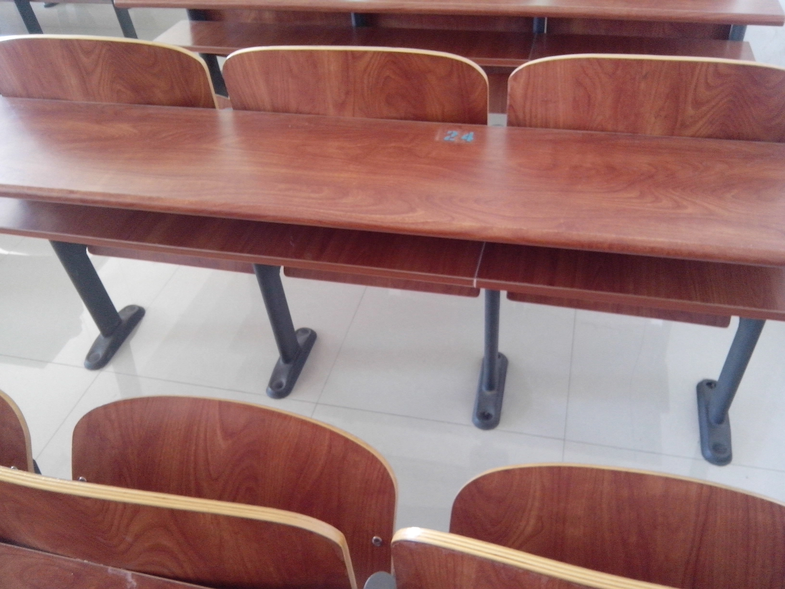

A510的座位（其实是在A510旁边的教室拍的，那个教室一直有人自习就没好意思进去拍照），大三一直自习的地方就大概是这个样子。

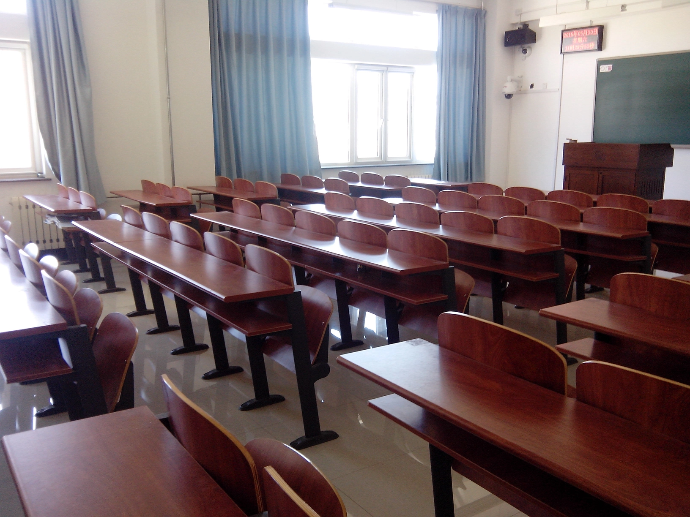

A510大概的样子（同样也是在旁边教室拍的，但格局效果基本相同）。相比A501，A510是个小教室。我在后期背政治的时候经常去A510。

9月份之后的考研复习生活基本是很枯燥的，每天早上起床之后基本就要准备学习。我属于那种早上起不来的那种，9点之前起来的情况都不太多。不过每天我会在教室待到关门的时候，大概是在晚上10点左右吧，一般情况都能10点多一些。那段时间我觉得过得也很充实，每天晚上会宿舍的路上总会想一些今天没有解决的问题，心中总有一种充实感和淡淡的兴奋和喜悦。我始终觉得，这样的生活似乎才是我希望有的生活，比起一天玩乐之后疲倦感，我更喜欢考研这样的生活。

> 如今回想，一方面是因为年轻干劲满满；另一方面，大概只是因为我觉得自己在努力，没有白白浪费这一天吧。
> 
> 以下的所有照片都是在毕业季的6月拍摄的，考研的时候为了专心，用的还是功能机呢。

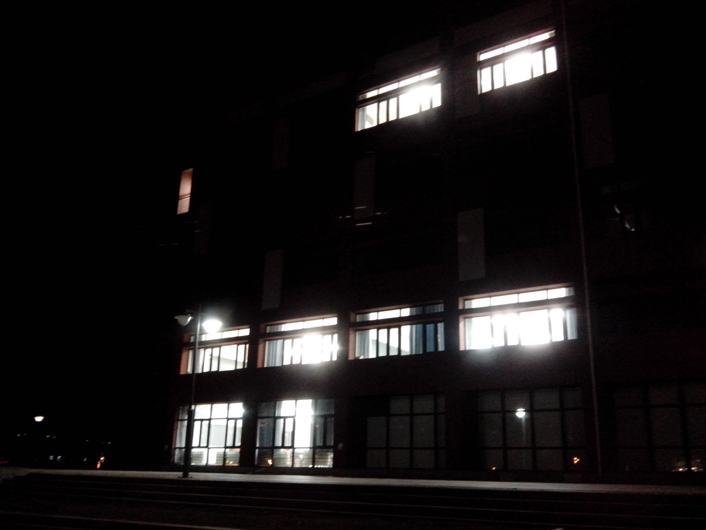

西综的夜晚景色。这张照片是我在毕业季的时候晚上特意到西综拍的，那个时候我在大工的时间也所剩无几了。

有一件比较有意思的事情，在回宿舍的路上有一盏路灯，由于快要坏了会亮一阵然后灭一阵。忽然有一天福至心灵，我给这个时亮时灭的灯封为灯神，并问了他几个问题。他回答的方式很简单，在我走多少步之内不灭，代表赞同；反之则不赞同。我问过几个问题，结果最后他都预测正确，不负“灯神”的称号。举例其中两个问题，第一个是“我会考入北京理工大学吗？”他的答案是“会”；第二个是“我会通过学硕复试吗？”他的答案是“不会”。后来我果然是调剂专硕进了北理工。哈哈。可惜等我调剂结束回到大连，没过多长时间路灯就彻底坏了，灯神也走了吧。哈哈。

> 生活中有点玄学也挺好，信则有不信则无，也是当时鼓舞自己的一种方式；或者是一种精神寄托吧。

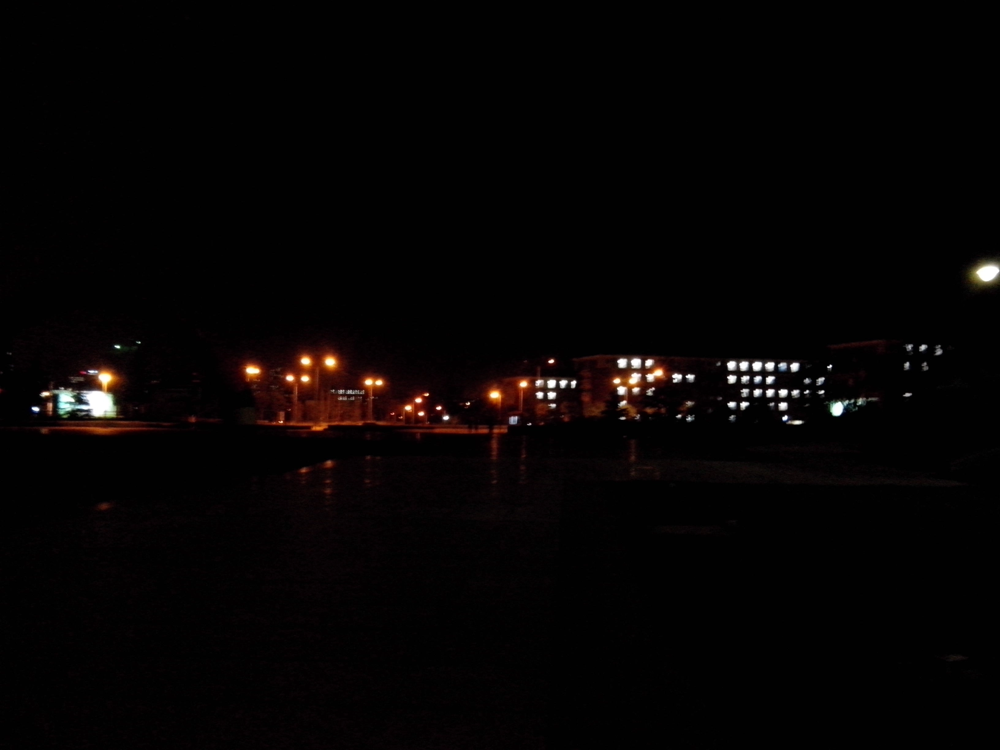

在西综回宿舍的路上，看西山生活区大致就是这样的。

> 确实看不清什么。现在看到照片，脑海中还会想起当年的灯光，和路上返回宿舍的人群。

下面是我的考研根据地-教室A501的一些照片：

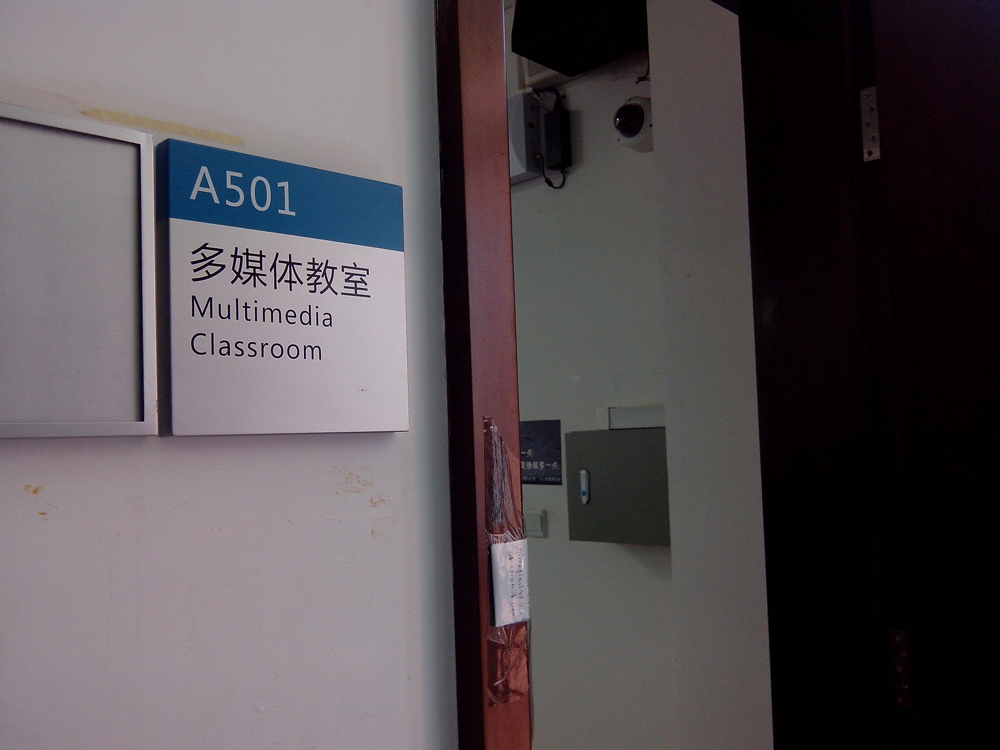

教室A501的前门就是这个样子的。我的大四下学期变成了考研教室：整个一个学期都没有课，所以里面有很多人自习、考研复习。

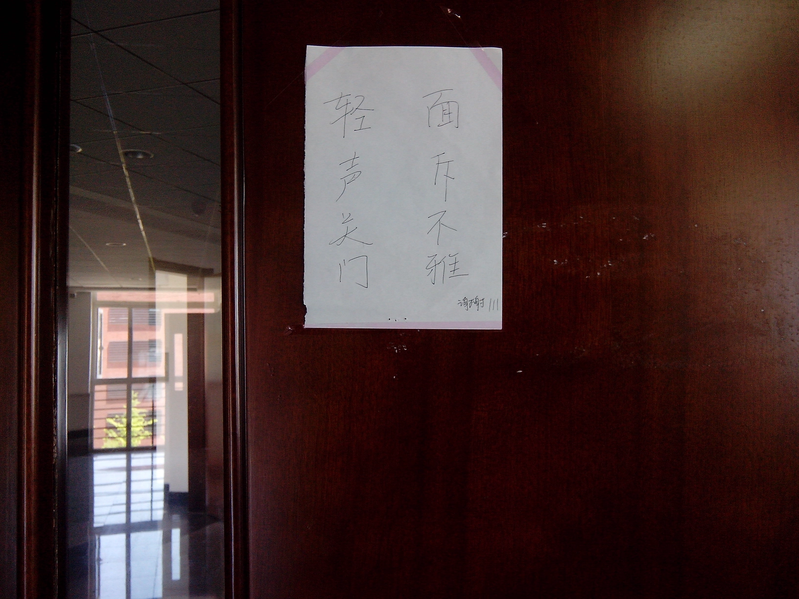

考研教室A501的后门经常开着，一般晚上西综要关门的时候才可能会有人关。“轻声关门 面斥不雅”这几个字就是在我考研复习的时候有人贴上的，我想它能一直留着吧。

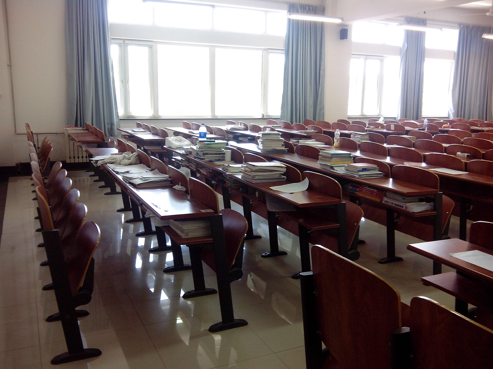

从后门看过去教室里就是这样。我就是在中间位置的倒数第二排的最左边的座位复习的，现在那个位置的书也很多，好像是个学弟占了吧，希望他也能好好复习，考研成功。

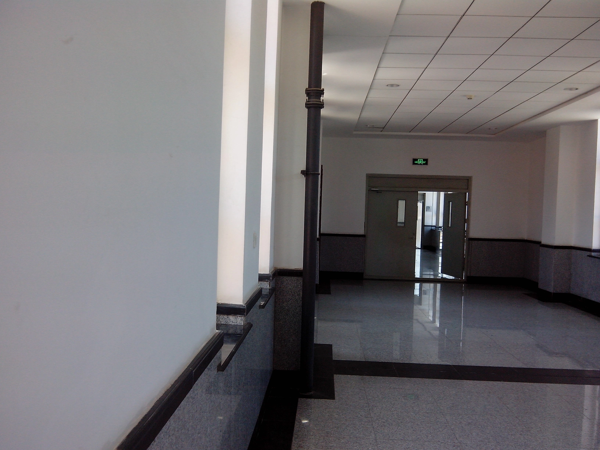

这是西综五楼从A座通往B座的走廊。我在这里背过英语和政治，在学不下去的时候也会到这里呆一会，当然记忆最深的还是在2014年的圣诞节，在走廊来回踱步拼命背考研政治的情景。在考研结束之后，我也时不时会来这里呆一会，来纪念我曾经奋斗的时光。

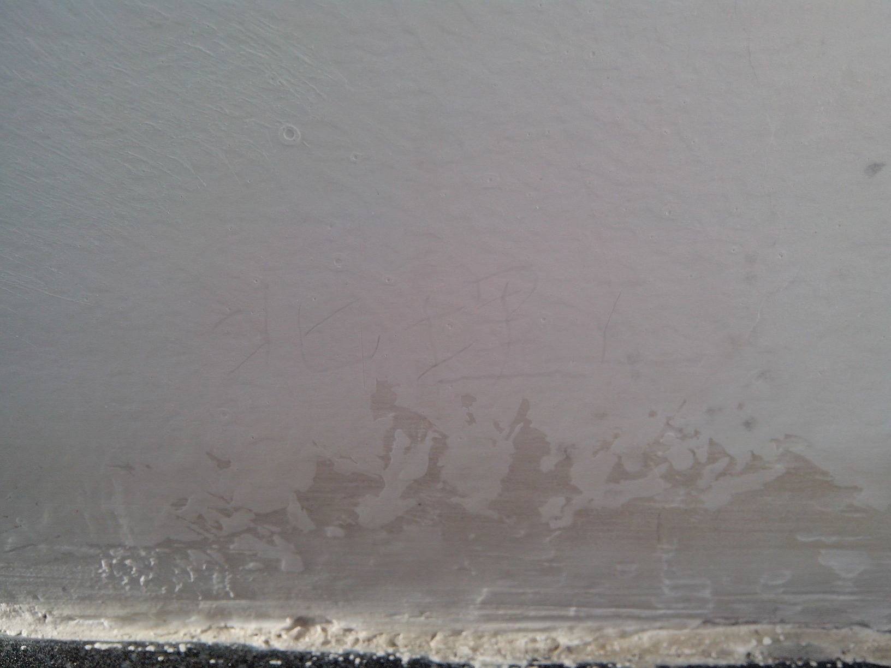

我在一扇窗旁边的墙上轻轻划下了“北理工”三个字，希望自己能实现这个目标。最终算是成功了，看到曾经的痕迹，岂无感慨？奋斗过的时光才有意义，才值得纪念吧。这一侧的窗子可以回望西山生活区，而另一侧就是西山之巅的风景了。

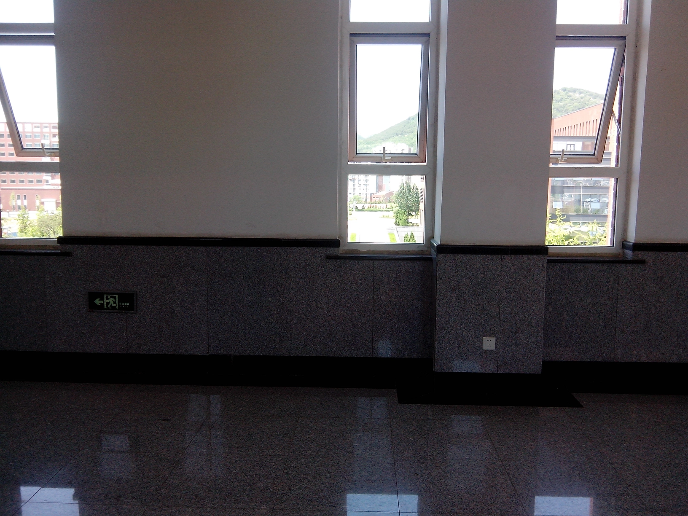

话说图上的插座，做毕设的期间我还使用过这个插座，当然是席地而坐的状态。

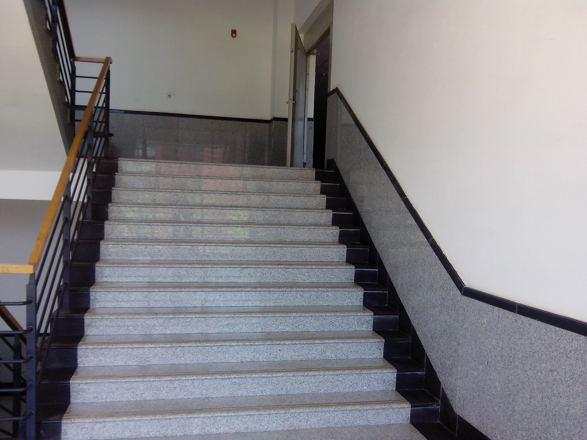

考研教室A501离一侧的楼梯间很近，而这个楼梯间有很大的窗子，窗外西山之巅的风景很好，我也经常来这里看。我也记得入冬的时候，有一次飘雪特别美，雪花飞舞，我就来到这里看，感觉真的很好，可惜没有留下那时候的照片。

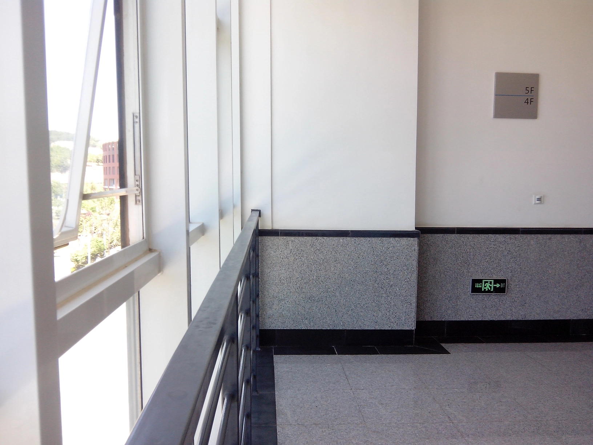

我曾经还在窗子上留下了些手掌的印记，不过应该是被保洁阿姨擦掉了吧，哈哈。

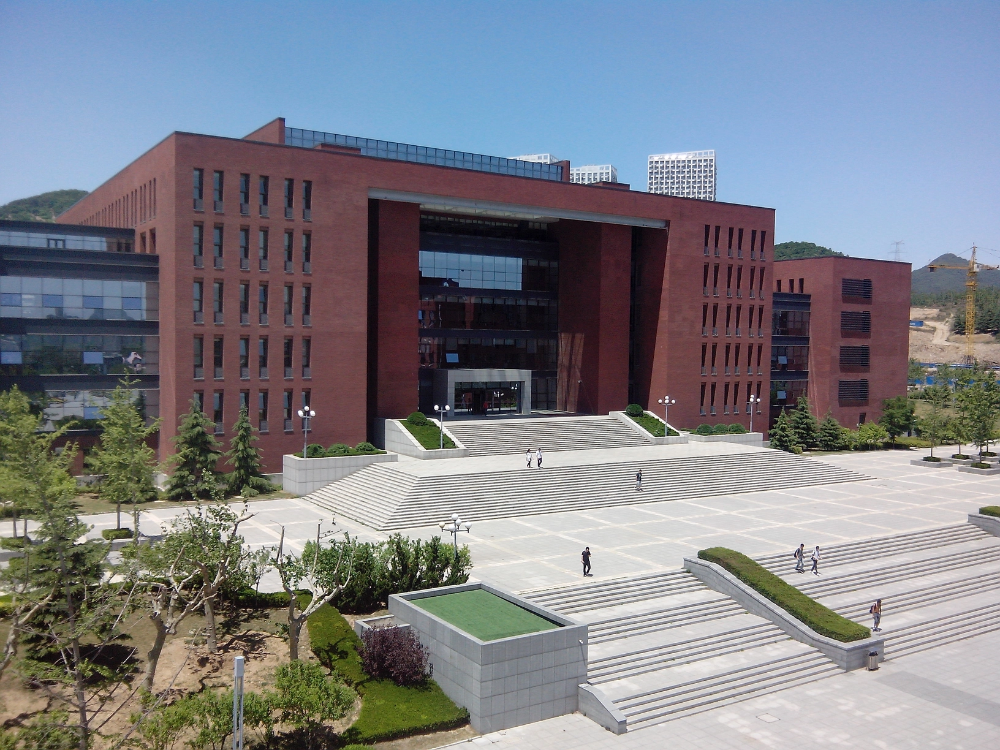

从这里的窗子看令希图书馆，很不错的景色。

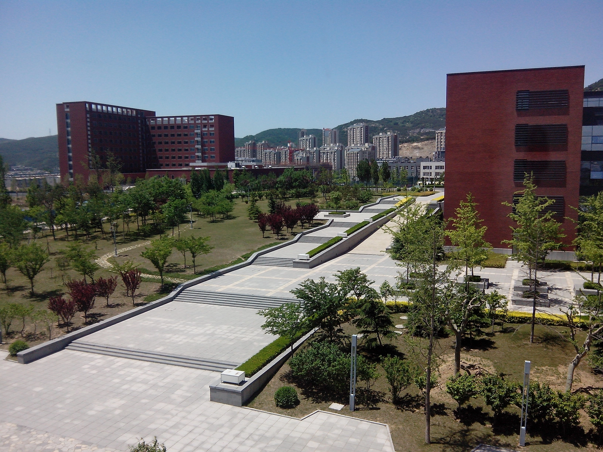

同样是从窗子里可以看到，从这条路走过去可以到西山的运动场。保研失利的时候正好是因为我是第八名，所以那一阵子经常绕着运动场的第八道一圈一圈地走，心中也是很郁闷的。每当感觉有压力的时候，我就喜欢走走。

> 后来这成了我排解压力或者情绪的一种方式，考研时复习不动了就会出去走一大圈，当时学校东边还有一片没有完全开发的区域，我也会走过去。大工真的挺大的。如今我也经常在午休的时候出去走走。

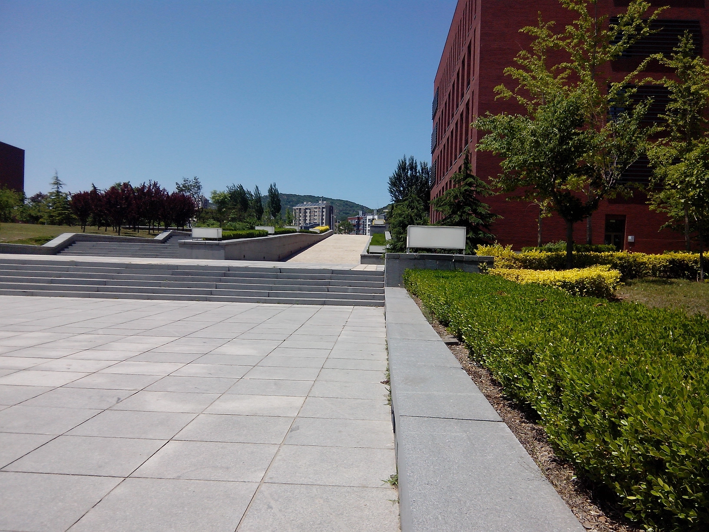

这个就是通往西山运动场的路。

我虽然保研失利了，但是我本来的研友杨同学成功保研东南大学。于是，剩下的考研课就只剩我一个人去上了。我记忆特别深刻的一次，大概是在11月份的某一次英语考研课，在周末上的。一个人上完课，走在海事大学回西门的路上，那个时候正好是大连的深秋。那个夜晚秋风起了，梧桐叶落了一地，又被风吹起。我突然就感到好凉的秋天，好孤单的一路。可能是因为我就是出生于秋季吧，我对秋天也有一种特别的感情，我相信这个秋天，那一刻的秋风与梧桐叶飞舞，也对我有特殊的意义吧。

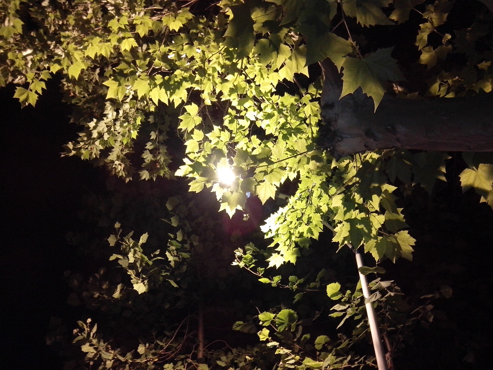

这是大工校内的梧桐树，拍摄时间也是在毕业季的时候，正值盛夏。可惜啊，大连秋天梧桐叶飘落的样子，这几年我应该是再也不能亲眼看到，亲身感受了吧。

考研的时间过得很快，一转眼就到了12月份。因为个人的情感发生了一些变故，也因为自己的复习计划不够好，复习的效果也不够好，最后要考试的几天我甚至有点放弃的感觉。现在想想，多么愚蠢的想法和做法，不到最后一刻，永远也不会直到结果如何，也不应该有放弃的想法。坚持不一定会成功，但放弃一定会失败。

## 研究生招生考试

2014年12月27日-28日，校历17周周末，研究生招生考试。

我算是幸运的，四门科目的考试地点都在距离大工只有一墙之隔的大连十七中，好多同学就并没有那么幸运了。我对于考试之前自己的状态的评价就两个字：糟糕。心态也很差，破罐破摔？大概是的。不过现在看来第一天的政治和英语答得还是挺不错的，反而是数学和专业课答得很差，数学连120分都不到，当时我可是想135分左右的。话说第一天的英语的七选五我几乎就是蒙的，现在看来答了69分，阅读理解应该是超常发挥了吧，距离我想英语上70的目标就差了一点。不过英语答完了就有点丧失信心了，毕竟在时间安排上稍微出了一些问题。晚上复习的时候碰到了任同学，最初认识他是一起在英语二级班的时候，也是很好的人。最终他是成功考研本校的计算机专业了，也很不错。和他一起复习了一个晚上吧，不过状态也是很差。第二天的数学答得就是很惨了，我记忆中大概有两个十分的大题几乎和没答差不多。最终115分的成绩加上两个10分的大题也才能实现135的目标吧，我的数学真是被我荒废了，大一的时候还不错呢。专业课我是都答满了，可能部分地方理解的不够好？最终的结果111也是超出了我的想象，我以为最差也在120以上了。总之，答完了感觉蛮差，也不敢想最后的结果怎么样。

另一张校园的梧桐，突然好怀念，怀念那个我生活了四年的校园。那个亮灯的地方就是一馆，同专业班的同学应该有在这里准备考研的吧。

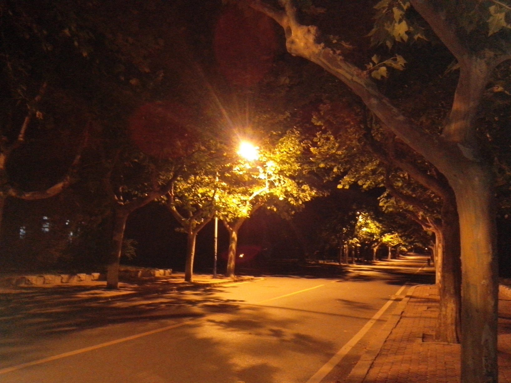

考完后意外再次碰到了赵同学，发现最后一科专业课我们的考场就是在不同楼层而已。因为考完了无所事事，我就跟着他一起去海事大学转了一转，也路过了曾经一起上考研课的地方。对了，突然想起，考研班点题课的时候我还看到他了，那个上午我们都来晚了。听了一上午的课他决定下午就不去了，考完后我告诉他：“幸好你没去听，我去听了他们的点题课，发现屁用没有。”哈哈。逛了一会，还在海事大学吃了晚饭。我们两个自我感觉成绩都应该不咋的，但是都互相鼓励着说不能放弃。拿出小马哥马云的话：“梦想还是要有的，万一实现了呢。”

> 后来也没怎么有赵同学的消息。我们也是高中同学，但并不是大学同学，只是离得很近。

之后就是艰难的等成绩的时候吧，回家过年也基本没怎么开心。2月12号成绩出来了，我分析卡在了能不能进复试的边缘上。后来证明事实确实如此，我的成绩354就比北理通信专业信号处理方向的复试线高了1分而已。可那个假期都不知道结果如何啊。怀着忐忑的心情，和应该尝试一下，好好复习的想法，正月初八我就离开家出发回学校了。接下来的故事，就是我的考研复试与调剂之路了。

## 复试与调剂

### 在北京，初次失利

2015年3月18日，出发去北京复试。得知自己进入复试也是小小的开心了一下，但一算比例得知进复试的28个人只会录取18个，淘汰率可想而知。复习得是一塌糊涂，笔试也还算凑合，面试就相当差了，抽签得到的面试顺序是第一组第一个，也是直接就吓傻了。面试表现得很差，既有知识储备不足，又有心理素质不够好，反正结果是被刷掉了。

这期间也找过几个调剂，大唐电信也几乎给了肯定的答复，但我咨询了李老师，他说大唐电信在行业内只能算是中等，比较学校的研究生肯定是有所不足。北理工的学硕复试时间是20日和21日，复试的结果却在四五天后才给出，这中间的几天时间住旅馆实在是住不起，偶然得知时雨在北京实习，联系他之后，他盛情邀请我去他那里住。我预感自己的路还很长，怕以后会需要更多的钱，加之一个人实在无趣，便欣然前往。

> 时雨是我的初中同学，当时他买了个带“福”字的苹果，朋友圈里还有留存照片。当时多亏他，后面他也在关键时刻出现帮忙。如今的他留在了鄂尔多斯，几乎每年过年也见不到。我也有很多年没见过他了。

感谢时雨，感谢他那一段时间的接济和精神支持。没有他的帮助，现在还不知道会是怎样一副样子。在家靠父母，出外靠朋友，尤其在困难的时候，朋友的价值就更不可替代。如今想起，仍然是满满的感动。
等结果的过程总是煎熬的，尤其是在心中特别没底的时候。大约在23日左右，我接到了上海中科院微系统研究所的调剂通知，思来想去，决定去试一试，买了北京去上海的高铁，第一次去了南方。

走的时候心中充满了希望，时雨也是送我到了北京南站。一路的高铁，速度特别快，路过了山东、南京，我也是第一次亲眼见到了南方的景色。然而路上就传来了坏消息：我没有通过北理工学硕的复试。我觉得失望，不过心中也有自知之明，上海的调剂应该是个机会。

### 在上海，再次失利

在上海虹桥火车站下了高铁，从北京到上海仅仅花费了六个小时左右的时间。我住的旅馆在一个叫华漕的地方附近，倒了一趟公交就到了地方。现在我还记得那个旅馆在二楼，门口的马路就特别宽，有一个十字路口和一个四边的大天桥。当然，我住的位置在上海的郊区，算是很偏僻的地方，和大上海的繁华完全不同吧。第一天晚上，自己还满怀希望，斗志昂扬，茫然不知最艰难的时刻即将到来。我先去了要面试的地方，走了一走，又熟悉了一下附近的路线。

夜里有些兴奋所以有一点失眠，第二天早上起床的时候惊讶于六点钟天已大亮。又恍然自己已经深处南方。上午的参观让自己更加满意于这个选择，也认识了来自华中科技大学的调剂小伙伴陈同学。上午的互相交流心中就没底了，小伙伴们每一个都非常优秀，科研经历，实习经历，本科知识都比我要强。那一刻我才体会到了自己大学几年过得实在是浪费光阴，错过了太多让自己变得更加优秀的机会。果然，下午的面试一塌糊涂，大约十一个人淘汰了三个，其中就有我。陈同学成功调剂了，他也很优秀，那时候我们还说要做校友，无奈自己实在太烂。突然心中充满了绝望感，到底怎么办？

> 回想当年的自己，也不是没做过一些努力，但相比那些同期参加调剂的同学，还是差的有点多。硬实力这种东西，不行就是不行。如果自己再努力一些？也许能保研、也许就能有更多科研和实习、也许就能初试分数更高、也许就能通过面试... 太多可能，可是“也许”并没有用，当年还远不如现在内卷，还是自己有点懒散了，可能更多是没想好，想要怎样的未来吧。

这个时候大概有了点运气，之前一起来北京参加复试的同学发信息问我，有没有准备参加北理工的专硕调剂？那时候自己已经一片茫然，就像溺水突然抓到了一根救命稻草。现在决定应该还来得及，片刻思考后，我决定立刻返回北京，放弃第二天上海这这边第二天的调剂面试。因为我非常着急，但是当天晚上的高铁票已经没有了，只能选择第二天最早的高铁，时间勉强来得及。

我不死心时刻关注着当天晚上的火车，突然发现有两张软卧将近1000元的车票。就当我想不顾一切代价购买这张票的时候，发现自己身上的钱已经不够了。给几个好哥们打电话想让他们帮我支付，惊悉他们都不会自己上网或者用手机买票，更别提支付宝使用了。耽误了我一阵时间后，还是阮同学可以帮我支付，然而已经在开车前的两个小时之内了，不能够网上买票。只好作罢。不能当晚上走就只能第二天早上走。

> 阮同学后来调剂到503所，之后留在了北京。读研期间我们吃过几次饭，不过等我毕业去上海后逐渐失了联系。等我再次换工作回北京、然后疫情，感觉一下就过了好多年。

### 上海的雨夜

为了不错过早上的高铁，我毅然决定晚上不能在旅馆住了，就在火车站将就一个晚上吧。然而到了晚上23点之后，由于晚上没有列车进站，虹桥火车站就关闭了，地铁站也相似。天公也不作美，下起了雨。

那是我过得最艰难的一个晚上，可能也带有自虐的性质，但身上确实没什么钱了。我在地铁站附近发现了一个工商银行的取款机房，里面排列着几台取款机，但是有空间可以避雨，我就在那里待了一夜。坐累了就站一会儿，站累了就走一会儿，也会看看模电数电，那个夜晚就那样过来了。

上海的雨下了整夜，到凌晨4点多，雨停了，我就走了出来，买了些面包和水，在地铁站前等候。这个城市逐渐醒来，我却觉得我的心疲惫不堪。但这些都是我应受的苦吧，如果我足够优秀，保研了就不会有今天；如果我足够优秀，可以通过北理工学硕的复试也不会有今天；如果我足够优秀，通过了上海中科院微系统所的调剂面试仍然不会有今天。那一刻，我突然开始痛恨自己以前的大学生活，那充满颓废与不堪的大学生活。

### 返回北京

大概是在5点左右，地铁开始运行。我乘坐地铁到了虹桥火车站，然后是候车。一切算是顺利，带我回到北京的高铁准时出发。一路忐忑，虽然在高铁上也小睡了片刻，但依然疲惫。到达北京南站，和我约好不得不耽误了一天班的时雨来南站接我了，我们尽可能快地乘坐地铁，终于在13点多一点的时候到了北京理工大学的正门门口，行李交给时雨暂时保管后，我走进了学校。

我终于赶上了北理工通信工程专硕的调剂，后面的事情变得顺利了起来。专硕的笔试难度并不大，自我感觉良好。27号晚上我回到住处，把第二天面试要用的材料又过了一遍。如今想来，因果玄妙如此，不可不叫人感慨。如果当年我拿到保研名额，一切都将简单许多吧。

第二天的面试难度不大，我也算给力了一下，记得特别清楚的是英语口语面试的老师很好。又等了两天，终于在30号得知自己被专硕录取。之后又停留了一天，办完了后续手续；把终于录取的消息同步给了之前心仪的导师，还简单见了一面。当夜和时雨把酒道谢，买了第二天回大连的动车票。

## 终于结束

2015年4月2日，在外漂泊十余日后，晚上10点，回到了大连，回到了大工。

这一趟，风雨无阻，终于有了还不错的结果，自己也因此获得了成长。这段经历，也是我大学之中最有意义的吧。哭过笑过，终于值得。
