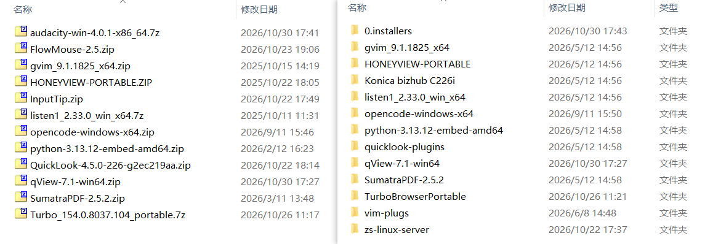

# 日常使用的Windows软件

以下是我工作中常用的Windows软件安装包截图。

都是无需安装，解压即用。

## 独立软件

以上还不够全，所有的总结如下：

| 名称 | 功能简述 |
|---|---|
| *Audacity* | 音频录制、剪辑和编辑工具。并不会用到，复制压缩包里的内容，给**qView**提供缺失的系统组件，少哪个就复制哪个。 |
| **FlowMouse** | 开源鼠标手势扩展，支持手势导航、超级拖拽、滚轮手势等。给内网的**Chrome浏览器**用。 |
| **gVim** | Vim 编辑器的 Windows 图形界面版本。**vim-plugs**是Vim的插件目录。 |
| *Honeyview* | 轻量图片查看器，常用于看图/漫画。版本不再更新，用**qView**替代。 |
| **InputTip** | 输入法状态提示工具，可在悬浮小窗中显示当前输入法状态。内网使用。 |
| **Listen1** | 多平台音乐聚合播放器。很久不更新但实在没有可替换的，凑合凑合用。 |
| **OpenCode** | 终端里的 AI 编程代理/编码助手。能用的版本是1.14.3，其他版本各种问题无法启动。 |
| **Python 3.13.12 embeddable** | 嵌入式 Python 运行时，常用于便携或打包环境。可以用**OpenCode**开发点Python脚本甚至程序来提升效率。 |
| **QuickLook** | Windows 上的快速预览工具，类似 macOS 按空格预览。**quicklook-plugins**是它的插件目录。 |
| **qView** | 轻量图片查看器。习惯了它的交互逻辑。 |
| **SumatraPDF** | 轻量 PDF/电子书阅读器。能免安装启动的版本是2.5.2，其他版本因为CA签名问题无法启动。 |
| **Turbo Browser** | Chromium 内核浏览器，内置了鼠标手势等功能。有免安装版本。 |
| *Eudic* | 欧路词典。以前偶尔用，现在很少用。付费AI翻译不如直接用DeepSeek。 |
| **Snipaste** | 截图软件。比Welink自带的截图好用多了。 |
| **LiCEcap** | GIF录制软件。偶尔用来录制GIF。 |

其中：
- 原本因为**qView**直接运行缺少系统组件，所以用了比较旧的**HoneyView**，但后来借助**Audacity**安装包的内容补充了之后，还是切换回了**qView**。
- 虽然**VSCode**很好用，但我喜欢用**Vim**，个人喜好而已。 

## 浏览器应用

现在的浏览器一般都可以针对特定网站，做应用安装。可以省去安装的麻烦，应用依托浏览器资源，有自己的进程。以下是我安装的浏览器应用：

| 名称 | 功能描述 |
|---|---|
| **DeepSeek** | 伟大无需多言。不过最近免费的网页版开始限额，建议下载ChatDemo，填上自己的apiKey使用。我司虽然自己也有大模型可用，但智能程度似乎一般。 |
| **WorkFlowy** | 无限层级列表的极简大纲笔记。多平台App，也支持直接使用网页版。记录、规划任务等，简单好用。 |
| **StackEdit** | 免费开源的Markdown编辑器，打开网页就能用，支持离线编辑和多云同步。可以使用GitHub的私有仓库，做笔记管理。 |
| **Excalidraw** | 在线虚拟白板工具，特点是独特的手绘风格，打开网页就开始画图。Windows WhiteBoard停用后的平替。 |

## 浏览器扩展

只增加必要的浏览器扩展。**Turbo浏览器**的一个特性是，可以同时支持Chrome浏览器和Edge浏览器的扩展。一般来说，Edge浏览器的扩展下载不太需要科学上网。

| 名称 | 功能描述 |
|---|---|
| **uBlock Origin lite** | 用于屏蔽广告，可以添加自定义规则。 |
| **AdGuard 广告拦截器** | 用于屏蔽广告，可以添加自定义规则。甚至可以设置某些网站的网页不再搜索结果中出现。 |
| **轻标签页** | 很长时间没有更新的标签页扩展，但简单好用，比起为了美观而增加很多无用功能，拖慢启动速度的标签页，这个足够用了。 |

## 关于浏览器

最后说点自己对浏览器的看法。刚上学的时候还用国产的搜狗浏览器，没有什么特别的原因就是感觉用着还可以；后来用了挺长时间的Opera浏览器，然而Opera国产厂家出手入股，老谭也自己去做了Vivaldi浏览器，当时跟着用了一段时间，最后还是因为国内的同步问题最后放弃。

接着是Edge浏览器，其实刚开始做的挺好的，国内同步什么的也方便。大概就是不久之前的一次更新，强制用户接受圆角边框，原本的可选项变成了必选项，我看网络上针对这个问题骂声一片，但至今没有等到微软的妥协，于是直接弃用。

用了一段时间Firefox，其实还挺好用的，有自己的内核也算是有自己的追求，可惜就是鼠标手势只能作为扩展，再浏览器自带的页面上不生效。后来发现了Turbo这个小众浏览器，作者更新挺勤的，像鼠标手势这种功能都内置，及时修复Bugs，我还提过两次issue，都得到了及时处理，感觉挺不错。

可能会有人疑惑为什么不用Chrome浏览器？这个纯属个人喜好，我比较偏爱小众简洁的软件，大概从选择Opera作为主力的时候就开始有这种倾向了。就像我对VSCode的态度一样，好用的确是好用，但总觉得用的人多，反而让我有点不太想用。说到底，Turbo本质上也是基于Chromium内核，其实并没有多少差别。
