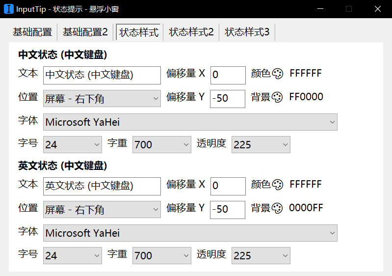
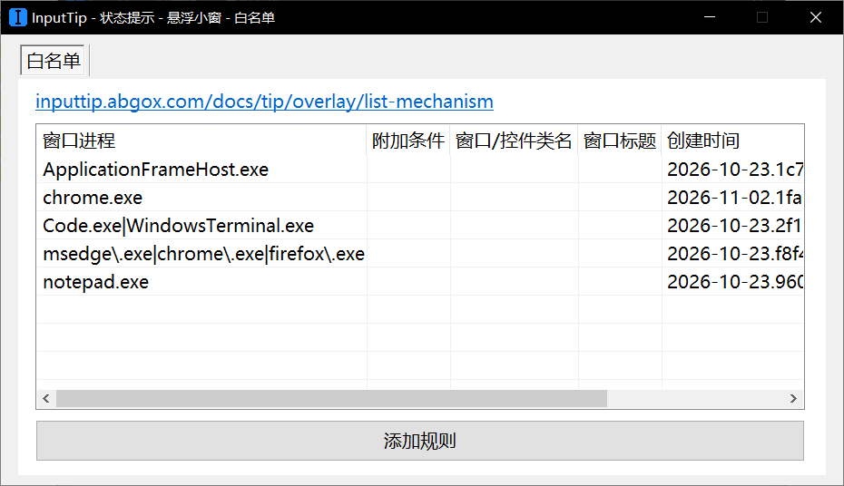
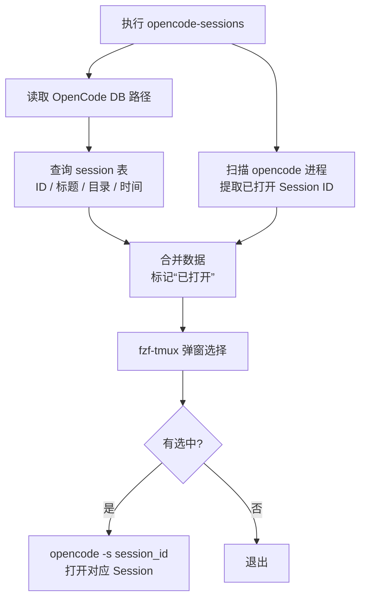

# 尝试OpenCode

<div align="right"><small>初版写于：2026-11-12</small></div>

AI时代，除了拥抱变化，别无他法。🙂

---

## 下载官方编译好的安装包

在GitHub上的[release版本页面](https://github.com/anomalyco/opencode/releases)，选择opencode-linux-x64.tar.gz进行下载，解压获得`opencode`程序。

## 尝试内网服务器运行（折腾手记）

在公司内网，我们组的研发主力服务器有两台，分别是server01和server02。其中，server01 是 CentOS 6.9，server02是CentOS 7（但我之前并不知道）。

我主要在 server01 上工作，主要是因为内存更大、用的人更少。但 CentOS 6.9 版本太老（CentOS 7 也没新到哪去），而 OpenCode 要求 CentOS 8+，所以想正常运行就得把依赖全部修好。

最初的想法是在server01上运行OpenCode，做了以下尝试：

- 绕过依赖修复（特别是 glibc），使用社区维护的 `opencode-AppImage-Enhanced` 版本：在 CentOS 上根本跑不起来；
- 尝试自行编译 glibc：CentOS 6.9 的 glibc 已被公司 IT 升级到 2.14，我又编译了一个 2.17。结果 `LD_LIBRARY_PATH` 指向了新编译的 glibc，导致所有程序都无法启动；把该路径从 `LD_LIBRARY_PATH` 中移除并重新编译后，才恢复正常；
- 通过 patchelf（从 GitHub Releases 页面获取）修改 opencode 程序，强行替换为刚才编译好的 glibc 2.17；运行后直接崩溃：` [1] 217450 segmentation fault (core dumped) ./opencode --version`。

> 修改 glibc 这样的基础组件一定要谨慎，不能让自己编译的 glibc 污染系统原有的 glibc；这里还要吐槽一下，OpenCode 在更早的版本对 glibc 的版本要求更高（2.25+），没想到版本更新后要求反而降低了（2.17+）。

到 segmentation fault 这一步其实已经没招了，后来按 DeepSeek 提供的方法定位到了原因：

```bash
➜ tools ./glibc-2.17/install/lib/ld-linux-x86-64.so.2 --library-path ./glibc-2.17/install/lib ./opencode (0s)[18:48:19][!10041]
============================================================
Bun v1.3.14 (0d9b296a) Linux x64 (baseline)
Linux Kernel v2.6.32 | glibc v2.17
CPU: sse42 popcnt avx avx2 avx512 Args: "./opencode" "--user-agent=opencode/1.19.3" "--use-system-ca" "--" 
Features: jsc standalone_executable
Elapsed: 8ms | User: 1ms | Sys: 6ms RSS: 24.77MB | Peak: 28.80MB | Commit: 24.77MB | Faults: 0

panic(main thread): Timer fail
oh no: Bun has crashed. This indicates a bug in Bun, not your code.

To send a redacted crash report to Bun's team, 
please file a GitHub issue using the link below: 

https://bun.report/1.3.14/Ba10d9b296EggggCwujhsCq6k5sC026tsC00hhsC8u5gsC6jnIA0eNoLycxNLVJIS8zMAQAUcwO+

[1] 234765 illegal hardware instruction (core dumped) ./glibc-2.17/install/lib/ld-linux-x86-64.so.2 --library-path ./opencode
```

以下是DeepSeek对于这个问题的解释：

> 你绕过了 glibc 的障碍，但撞上了更底层的限制：**Bun 运行时（OpenCode 内置的）与 CentOS 6.9 的内核不兼容**。
>
> 你看到的 `Timer fail` 和 `illegal hardware instruction`，根源在于 Bun 官方要求 Linux 内核版本至少为 **3.10**（RHEL 7 级别）。你的系统显示 `Linux Kernel v2.6.32`，远低于这个最低要求。Bun 内部依赖的定时器机制和系统调用在 2.6 内核上无法正常工作，导致它启动即崩溃。[<sup>【1】</sup>](https://bun.sh/docs/installation)[<sup>【2】</sup>](https://bun.sh/docs/installation.md)[<sup>【3】</sup>](https://bun.com/docs/installation.md)
>
> ### 为什么这条路走不通
>
> 1.  **内核版本是硬性门槛**：Bun 官方文档明确说明，它可以在低至 3.10 的内核上运行，但对更新的系统调用会进行“优雅降级”。你的 2.6.32 内核不在支持范围内，定时器（Timer）相关的底层系统调用行为不一致，直接触发了 Bun 的 panic。[<sup>【4】</sup>](https://bun.sh/docs/installation)[<sup>【5】</sup>](https://bun.sh/docs/installation.md)
>    
> 2.  **OpenCode 本质上是 Bun 程序**：你看到的 `Bun v1.3.14` 输出证实，OpenCode 的二进制文件是用 Bun 打包的可执行程序。你无法将 OpenCode 与它内置的 Bun 运行时分离，所以 Bun 不兼容，OpenCode 就必然崩溃。
>    
> 3.  **glibc 2.17 解决不了内核问题**：你之前编译 glibc 的努力，解决的是“库版本”问题。但 `Timer fail` 是“内核接口”问题，glibc 只是 C 库，它无法改变内核的行为。
>    
> ### 结论与仅剩的选择
>
> 在 CentOS 6.9（内核 2.6.32）上，**没有任何可行的方法能让官方或常规构建的 OpenCode 普通 Linux 二进制文件运行起来**。内核版本这个限制无法通过替换用户态库来绕过。
>
> 你之前调查过的 **`opencode-AppImage-Enhanced`** 仍然是唯一理论上的希望，但前提是它的维护者不仅打包了 glibc，还设法规避或适配了 Bun 对内核 3.10+ 的依赖（这通常极难做到）。如果那个版本也无法运行，那么在 CentOS 6.9 本机使用现代 AI 编程助手的需求，基本可以被判定为不可行。

本来感觉无望了，随手在 server02 上查了一下内核版本，发现居然正好是 3.10。这才后知后觉地发现 server02 是 CentOS 7，把 `opencode` 这个程序上传、执行，直接就运行起来了。😶

所以之前就是白折腾一番，系统合适的话，运行起来就很丝滑。怪不得server02用的人多，原来是因为系统版本领先一步。🐸

## 记录配置修改

因为 `opencode` 是编译好的程序，可以直接放到系统的可执行目录（如 `/usr/local/bin`）下，这样在任意路径下直接输入 `opencode` 都可以启动。剩下就是一些配置修改，再接入公司内网的大模型。

配置OpenCode的一些默认参数，在`~/.cshrc`中增加：
```csh
setenv OPENCODE_DISABLE_DEFAULT_PLUGINS 1
setenv OPENCODE_DISABLE_MODELS_FETCH true
setenv OPENCODE_EXPERIMENTAL_OUTPUT_TOKEN_MAX 256000
setenv OPENCODE_EXPERIMENTAL_DISABLE_COPY_ON_SELECT 1
```
其中 `OPENCODE_EXPERIMENTAL_DISABLE_COPY_ON_SELECT` 是我额外加的，主要是为了配合 Windows Terminal 的右键复制行为，选中后由我自己决定是否要复制，而不是选中就复制（其实差别不大）。

创建配置文件`~/.config/opencode/opencode.json`，内容如下：

```json
{
    "$schema": "https://opencode.ai/config.json",
    "disabled_providers": ["opencode"],
    "provider": {
        "my-gateway": {
            "npm": "@ai-sdk/openai-compatible",
            "name": "My AI Gateway",
            "options": { 
              "baseURL": "http://your-gateway.example.com/v1",
              "apiKey": "apiKey_apiKey_apiKey"
            },
            "models": {
                "my-model": {
                    "limit": { "context": 262144, "output": 64000 },
                    "variants":{
                        "medium": { "reasoningEffort":"medium" },
                        "low":    { "reasoningEffort":"low"    },
                        "xhigh":  { "reasoningEffort":"xhigh"  }
                    },
                    "modalities": {
                        "input": ["text", "image"],
                        "output": ["text"]
                    }
                }
            }
        }
    },
    "model": "my-gateway/my-model"
}
```

OpenCode 启动后也可以选择模型；一般来说，前面配置好了这里就不用改。

1. 执行 `/connect` 并回车后，Provider 选择 `My AI Gateway`，然后 API Key 填写上面 JSON 文件里的那个；
2. /models + 回车之后，选择`My AI Gateway`下的 `my-model`，其他的选了也不能用。

## 外观：显示效果增强

为了增强OpenCode显示效果（涉及到中文显示、输入法切换等），我在Windows服务器上补充了一些辅助软件。都是**解压即用，无需安装**。

### WindowsTerminal：更现代的终端软件

原本公司内网的终端软件是Mobaxterm，优点是自带X server可以支持GUI的转发，即终端环境下也可以启动GUI界面；缺点是字体、显示略微粗糙，特别是对于中文显示。古法编程其实并不需要中文，但AI编程还是用中文交流更方便。

在微软官方的[网站](https://learn.microsoft.com/zh-cn/windows/terminal/install)，或者去GitHub Releases[发布页](https://github.com/microsoft/terminal/releases)下载。解压后直接双击exe即可运行。

一些Windows Terminal的快捷键：
- 新增Tab标签页：`Ctrl + Shift + T`；
- 切换Tab标签页：`Ctrl + Tab`；
- 复制选中内容：右键；
- 粘贴：右键 或 `Shift + Insert`。

建议使用powershell作为默认终端，好处有：
- 可以设置服务器免密登录（当然一般终端都可以）；
- 可以支持一些类似于`alias`的简单快捷方式，和Windows本地的一些操作结合得更好。

#### 免密登录

> 设置免密登录核心步骤：
> 1. 在当前机器上本地生成密钥对：`ssh-keygen -t rsa -b 4096`，如果是系统版本比较新的服务器，可以换成Ed25519算法来生成；
> 2. 将生成目录下的公钥（通常在`~/.ssh/id_rsa.pub`）上传到服务器：复制公钥内容，添加到服务器上的`~/.ssh/authorized_keys`文件中；CentOS对权限要求比较严格，补上`chmod 600 ~/.ssh/authorized_keys`；
> 3. 验证免密登录是否成功。

#### 自定义快捷命令

获取 PowerShell 配置文件路径：
```powershell
echo $PROFILE
```
会得到一个类似 `C:\Users\你的用户名\Documents\WindowsPowerShell\Microsoft.PowerShell_profile.ps1` 的路径。
如果文件不存在，先创建（也可以手动进入对应文件夹，新建同名文本文件）：
```powershell
New-Item -Path $PROFILE -Type File -Force
notepad $PROFILE
```
设置免密登录后，我的配置文件内容如下：
```powershell
Set-Alias dailyruns "C:\Users\dubin\Documents\Scripts\dailyruns.bat"
function t1 { ssh dubin@server01 }
function t2 { ssh dubin@server02 }
```
只需输入 `t1` 或 `t2` 就能直接登录这两台服务器。中途遇到了一些问题，DeepSeek 给出了解决方案：

> **注意**：如果提示“禁止运行脚本”，详细信息例如：
> ```powershell
> 无法加载文件 C:\Users\dubin\Documents\WindowsPowerShell\Microsoft.PowerShell_profile.ps1，因为在此系统上禁止运行脚本。有关详细信息，请参阅 https:/go.microsoft.com/fwlink/?LinkID=135170 中的 about_Execution_Policies。
> 所在位置 行:1 字符: 3
> ```
> 只需要在Windows Terminal 的 PowerShell 标签页里，直接运行下面这条命令：
> ```powershell
> Set-ExecutionPolicy -ExecutionPolicy RemoteSigned -Scope CurrentUser
> ```
> 执行后如果提示确认，输入 `Y` 并回车。为什么这条命令符合你的要求：
>
> **不需要管理员权限**：`-Scope CurrentUser` 参数明确将修改范围限定为你自己的用户账户，只影响当前用户，不会改动系统全局设置。微软官方文档也确认，`CurrentUser` 作用域的优先级高于 `LocalMachine`，且普通用户即可修改。[<sup>【6】</sup>](https://zenodo.org/records/21733069#2)[<sup>【7】</sup>](https://learn.microsoft.com/fr-fr/powershell/module/microsoft.powershell.core/about/about_execution_policies?view=powershell-7.4&viewFallbackFrom=powershell-6#1)
>
> **`RemoteSigned` 是合理的安全折中**：它允许运行本地创建的脚本（比如你自己写的配置文件），但从互联网下载的脚本仍然需要数字签名。这比 `Bypass` 或 `Unrestricted` 更安全，也是微软推荐的日常使用策略。

另外，这个 dailyruns 任务的功能是：
1. 根据当前日期，在服务器上获取 `Result-YYYYMMDD.md` 和 `ResultAverage.md` 文件（这两个都是服务器上的日常测试结果，每天自动生成和更新）；
2. 下载两个文件到本地 Downloads 文件夹，然后打开 `ResultAverage.md`，同时打开 Downloads 文件夹。

这样我可以直接查看打开后的 Markdown 内容；如果当天结果有问题，由于 Downloads 文件夹已经打开，我可以直接打开当天具体的 Markdown 文件查看。dailyruns.bat 脚本内容如下：

```batch
@echo off
for /f "tokens=2 delims==" %%a in ('wmic OS Get localdatetime /value') do set "dt=%%a"
set "yyyymmdd=%dt:~0,8%"

scp -i C:\Users\dubin\.ssh\id_rsa dubin@server01:~/dailyruns/Result-%yyyymmdd%.md "C:/Users/dubin/Downloads/"
scp -i C:\Users\dubin\.ssh\id_rsa dubin@server01:~/dailyruns/ResultAverage.md "C:/Users/dubin/Downloads/"

start "" "C:\Users\dubin\Downloads"

"C:\Program Files\MarkText\MarkText.exe" "C:\Users\dubin\Downloads\ResultAverage.md"
```
补充解释：
1. start 可以直接打开目标文件夹，这是批处理与 Windows 系统交互的便利之处；
2. MarkText 是一款 Markdown 编辑器，可以预览内容。

### InputTips：提示输入法当前的状态

原本基本不需要这个功能：古法编程时代，内网很少输入中文，我都是直接切到纯英文输入法。但用 AI 编程就不一样了，还是需要输入中文交流，所以及时提示当前输入法状态还是有必要的。

[下载页面](https://inputtip.abgox.com/zh-cn/download/) 是一个很小的软件，只有 1261 KB。解压后双击 `.bat` 文件运行。

它提供的配置项还挺丰富，我主要配置了“**状态提示-悬浮小窗**”这一项，目的是在切换输入法时，在右下角提示当前输入法状态。配置方法可参考：



PS：我一般会隐藏语言栏，以免影响全屏体验，只在需要时提示。

通过白名单功能，只在特定程序中显示输入法状态：



## 使用：提升易用性

这一部分主要修复在 tmux 里使用 OpenCode 的小问题，并封装快速选择历史 Session 的命令。

### 配合tmux使用

在 OpenCode 中选中文本后，默认会直接显示 `Copied to Clipboard`（选中即复制）。如果配合 tmux 使用，默认情况下复制的内容**并不会**同步到系统剪贴板，这和直接在 tmux 里用普通终端复制的行为不同。需要在`~/.tmux.conf`中添加：

```bash
set -g set-clipboard on
set-option -g allow-passthrough on
```
这样就可以正常使用 Windows Terminal 的右键复制；粘贴时要使用 `Shift + Insert`，不能用右键。

右键粘贴不可用的原因是 OpenCode 会拦截鼠标事件，这是它内部默认行为导致的。可以通过在`~/.config/opencode/tui.json`中设置：
```json
{
  "mouse": false
}
```
来关闭；或者在 `~/.cshrc` 中设置 `setenv OPENCODE_DISABLE_MOUSE 1`。但**不推荐**这样做，因为这样鼠标滚轮在 OpenCode 里就不会向上翻对话，而是像终端一样显示上次输入的内容。

### 显示历史 Session（基础版本）

OpenCode 通过 SQLite3 数据库存放历史对话信息。可以通过 `opencode db path` 查看默认数据库路径。

因此只需封装数据库打开和查询操作，alias 成一条命令即可。以下是 DeepSeek 给出的方案：

```csh
alias opencode-sessions 'sqlite3 -header -column -cmd ".width 0 20 0 0 40" `opencode db path` "SELECT id,directory,datetime(time_created/1000,'"'"'unixepoch'"'"','"'"'localtime'"'"') AS created_time,datetime(time_updated/1000,'"'"'unixepoch'"'"','"'"'localtime'"'"') AS last_active_time,title FROM session ORDER BY time_updated DESC;"'
```
注意：整条命令用单引号包住，因此里面的双引号不需要转义；但里面的单引号需要通过 `'"'"'` 转义。执行 `opencode-sessions` 的效果如下：

```bash
[dubin@server02 ~]$ opencode-sessions
id                              directory             created_time         last_active_time     title
------------------------------  --------------------  -------------------  -------------------  ----------------------------------------
ses_e3ac19143ffezuDis5WGpOlKXE  /home/dubin/tmp       2026-11-10 19:36:05  2026-11-10 20:15:44  项目 C 10ps 差异对比
ses_e3c906ae2ffe70VKB6c0SUV7GW  /home/dubin/tmp       2026-11-10 11:10:32  2026-11-10 17:38:41  <tool_call>
ses_e3bbffbdfffeLMtmJ1yfP86lZl  /home/dubin/tmp       2026-11-10 14:58:12  2026-11-10 16:47:21  项目 A 与项目 B 的 Pin TD setup/hold 差异
ses_e597f01ffffee394ZlX1fbcmxr  /home/dubin/proj-a    2026-11-04 20:20:33  2026-11-06 18:31:28  AGENTS.md creation
ses_e78734642ffespWx2exW7olMaV  /home/dubin/proj-b    2026-10-29 20:05:09  2026-11-05 14:16:37  读取 foo.h/.cpp 内容
```

注意，SQLite3 对中文和英文的显示宽度计算不同，会导致列对不齐，因此我把含中文的 `title` 列放到了最后，作为临时规避。
至于原因，DeepSeek 的解释如下：

> 准确地说：**SQLite CLI 的列模式对齐，取决于每个字符它"以为"占多少宽度，而它用的是 `strlen` 式的字符计数，不是终端实际显示的显示宽度（wcwidth）**。所以：
>
> -   纯 ASCII：每个字符显示宽度 = 1，它数得对，对齐完美。
> -   中文/日文/韩文（全角字符）：终端显示占 **2** 格，它只数成 **1** 格，补的空格就少了一半，于是错位。
> -   一旦某行混了中英文，错位程度还随中文字数变化，看起来更乱。
>
> 所以不是"对不齐"是随机的，而是**只要含全角字符，固定会短补**。这就是你看到的现象。

如果需要打开对应的 Session，例如第一个，只需执行：`opencode -s ses_e3ac19143ffezuDis5WGpOlKXE`。

### 借助 fzf 模糊选择历史 Session（进阶版本）

基础版本显示历史 Session 的方法还需要手动复制一次；我希望做成可选菜单，选中后回车就能自动打开。咨询 DeepSeek 后，借助 fzf 是最容易实现的方案。其中 `fzf` 是模糊选择器，`fzf-tmux` 是 fzf 自带的 tmux 包装脚本，用于在 tmux 弹窗中运行 fzf；安装 fzf 后通常就有。

也许已经有插件能实现，但受内网限制，而且功能不复杂，所以直接用 AI 辅助生成即可。先看效果：


有点慢，主要原因是 SQLite3 数据库操作和 OpenCode 启动本身。🐸

在 `~/.cshrc` 里增加一行 `alias opencode-sessions ~/scripts/opencode-sessions.sh`，核心脚本内容如下：

```bash
#!/bin/bash
db=$(opencode db path)
# db=$(opencode debug paths db) # for OpenCode v2

open_ids=$(ps aux | grep opencode | grep dubin | grep ses | awk -F' ' '{print $13}')
open_tag=$'\033[1;32m[已打开]\033[0m'

# change "FROM session" to "FROM session_v2" when upgraded to OpenCode v2
selected=$(sqlite3 -separator $'\t' "$db" \
  "SELECT id,title,directory,datetime(time_created/1000,'unixepoch','localtime') AS created_time,datetime(time_updated/1000,'unixepoch','localtime') AS last_active_time FROM session ORDER BY time_updated DESC;" \
  | while IFS=$'\t' read -r id title rest; do
      if echo "$open_ids" | grep -qxF "$id"; then
        echo "$id"$'\t'"$title"$'\t'"$rest"$'\t'$open_tag
      else
        echo "$id"$'\t'"$title"$'\t'"$rest"$'\t'
      fi
    done \
  | fzf-tmux -p 60%,60% --ansi --delimiter=$'\t' --with-nth=6,2 \
  --preview 'echo "ID: {1}"; echo "Title: {2}"; echo "Directory: {3}"; echo "Create Time: {4}"; echo "Last Update Time: {5}"' \
  --prompt="选择 OpenCode Session > " --height=40% --reverse)

if [ -n "$selected"  ]; then
  session_id=$(echo "$selected" | cut -f1)
  opencode -s "$session_id"
fi
```

核心功能说明：
1. 通过 SQLite3 获取 Session 信息：ID、标题、目录、创建时间和最后更新时间，和基础版本基本一样；
2. 通过现有打开的 OpenCode 进程信息，提取已经打开的 Session ID 信息（用于粗略判断）；
3. 借助 Bash 的 while 循环，在匹配到已打开的 Session 后加上一列“<font color=green>[已打开]</font>”；
4. 通过配置 fzf，菜单部分显示标题和已打开状态两列（即第 6 列和第 2 列），预览部分通过 echo 打印一些信息；
5. 一些 fzf 配置说明：`-p WIDTH% HEIGHT%` 配置弹出窗口大小，`--ansi` 解析输入中的 ANSI 颜色码；
6. 对于选中的条目，将 Session ID 传给 `opencode -s $session_id` 打开。

整体流程如下：



PS：判断 Session 是否已经打开只能做粗略判断，因为仅看进程信息并不一定会有 Session ID。

简单来说，直接执行 `opencode` 会打开一个新的 Session，但这个进程里没有 Session ID；通常只有用 `opencode -s ses_XXXX` 打开时才会有。要精确判断，就必须单独存储和管理 Session ID，应该有现成插件能做到，但没必要。

> 关于 OpenCode 从 v1 升级到 v2 的改动：在尝试给 OpenCode 增加自己写的插件时，发现 v1 版本基本不能用，于是升级到 v2 尝试。目前 v2 的插件也没搞通，但也带来了一些变化：
> 
> 1. 只要运行过一次 v2，数据库格式就会改变，原本的 `session` 表变成 `session_v2`，导致 SQLite3 脚本不可用；
> 2. 对 SQLite 版本要求更高，建议使用较新的 sqlite3 CLI，否则可能无法支持新版数据库语法；
> 3. OpenCode 获取默认数据库路径的命令变了，改为 `opencode debug paths db`；
> 4. 新增了 sessions 标签功能，但我觉得不需要，可以新建 `tui.json` 里面把 `tabs` 给off掉。
>
> 以上改动已在脚本中增加注释。没办法，现在我在公司内网用的版本只能强制变成v2

## 写在最后

公司在内网部署大模型已经有段时间了，受限于服务器的系统版本，一直没能用上 IT 部署在内网的 OpenCode。后来我自己传了一个 OpenCode 1.19.5 进去（当然还是要走内部审核流程），折腾了半天，终于跑了起来。

本来我是想先在小组内部几个人小幅使用的，主要是因为公司的大模型并发额度有限，工作日上下午的速度大概也就 10 tokens/s，用的人越多越慢。

结果没几天，其他组的同事也陆续用上了，属实是“独乐乐不如众乐乐”，倒显得我最初格局小了点。😂

不过说到底，AI 还是要拥抱的。但即便有了 AI，自己对业务的理解还是要不断加深，否则很容易变成可有可无的人。目前体验一般，主要是速度问题，不过对某些任务，AI 确实能做得更快更好。

继续努力吧。
